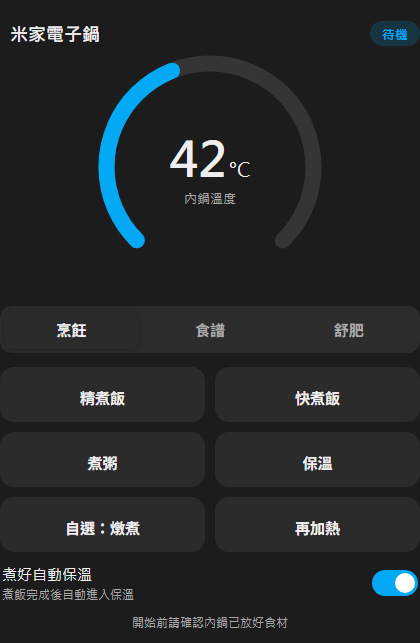
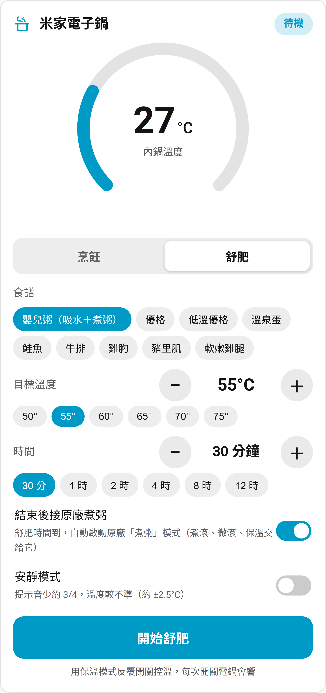
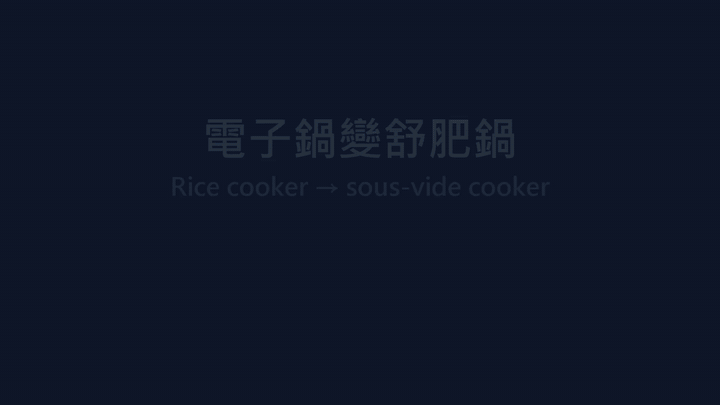
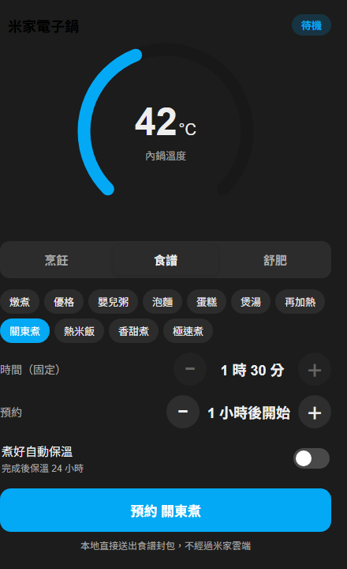

# Xiaomi Mijia Mini Rice Cooker × Home Assistant — a sous-vide cooker hack

**English** | [繁體中文](README.zh-TW.md)

Turn a cheap smart rice cooker (**Xiaomi Mijia Rice Cooker mini, `chunmi.cooker.tw1`**, the Taiwan model) into a
customizable low-temperature / sous-vide cooker, with a nice Home Assistant dashboard card.

The cooker exposes **no target-temperature setting**, but its recipes are plain 176-byte packets
(header + heating curve + CRC) that it accepts over the **local network**. This project:

1. **Starts any of the 15 built-in recipes from Home Assistant, including the app-only ones such as yogurt**, with
   your own duration, scheduled start and auto-keep-warm, without the Xiaomi cloud
   ([format](docs/recipe-format.md)).
2. Builds a **sous-vide mode** by watching the pot temperature and switching the built-in "keep warm" mode on
   and off (a thermostat built from automations).

> **Not affiliated with Xiaomi.** This is a hobby reverse-engineering project. Use at your own risk — read the
> [safety notes](#safety-and-limits) first.


<p align="center">
 
 
</p>

*Screenshots are rendered from the real card; the “running” states use sample values.*



[](https://youtu.be/iS_5qySGZCk)

**▶ [Watch on YouTube](https://youtu.be/iS_5qySGZCk)** (≈44 s) | [download the 1080p mp4](docs/demo.mp4)

## What you get

- A custom Lovelace card `custom:cooker-card` with three tabs: temperature ring, status chip, two-tap
  confirmation, countdown.
- **Cook tab**: the 6 start modes (Fine Cook, Quick Cook, Congee, Keep Warm, *Custom slot*, Reheat) and an
  auto-keep-warm switch.
- **Recipes tab (new)**: all 11 recipes beyond the basic modes - Stew, **Yogurt**, Baby porridge, Instant
  noodles, Cake, Simmered soup, Reheat, Oden, Hot rice, Sweet rice, Speed rice - with adjustable cooking time
  (within the recipe's own limits), **scheduled start** and auto keep warm; yogurt also has an experimental
  **fermentation temperature** (30–50 °C). The packet is built in the browser and sent locally.
- **Sous-vide tab (external control)**: any target 30–~75 °C, any time up to 24 h, normal (±1 °C) or quiet
  (±2.5 °C, ~¼ of the beeps) mode, over-temperature / sensor-loss protection, presets (soft-boiled egg, salmon,
  steak, chicken breast …) and a two-step baby-porridge recipe (55 °C soak, then the native congee program).
- [`tools/cookcode.py`](tools/cookcode.py) and [`data/recipes.json`](data/recipes.json): build and send recipe
  packets from scripts and automations.
- [Recipe format](docs/recipe-format.md) and [protocol notes](docs/protocol-notes.md): everything we learned
  (and did not learn) about this cooker.



## What does *not* work (and why)

- **Free-form heating curves.** The curve inside a recipe packet (bytes 20–173) is only partly decoded (target
  temperature and power of a phase are known), so for now only the header (time, schedule, keep-warm) plus the
  yogurt temperature are editable in the card. You can run the 15 built-in recipes, not design new ones.
  See "What is still unknown" in the [recipe format](docs/recipe-format.md).
- The Sous-vide tab still works by switching Keep Warm on and off, so every start/stop makes the cooker
  **beep**. Quiet mode reduces how often, it cannot silence it. (The Recipes tab starts once and does not beep
  repeatedly.)
- Boil-type recipes (cake, instant noodles, rice) heat flat-out to ~100–105 °C by design.

## Requirements

- Home Assistant with the [`xiaomi_miot`](https://github.com/al-one/hass-xiaomi-miot) integration
  (local mode), with your cooker added. Entities are expected as `sensor.chunmi_tw1_c3d7_cooker`,
  `sensor.chunmi_tw1_c3d7_temp`, `button.chunmi_tw1_c3d7_cancel_cooking`, … — replace `c3d7` with your device's
  suffix in the YAML and in the `E` table at the top of `card/cooker-card.js`.
- Helpers from [`ha/helpers.yaml`](ha/helpers.yaml) and automations from
  [`ha/automations.yaml`](ha/automations.yaml).

## Install

1. **Helpers**: merge `ha/helpers.yaml` into `configuration.yaml` (or create the same entities in the UI), restart.
2. **Automations**: append `ha/automations.yaml` to your `automations.yaml`, edit the entity IDs, reload.
3. **Card**: copy `card/cooker-card.js` to `/config/www/cooker-card.js`, then *Settings → Dashboards →
   Resources → Add*: URL `/local/cooker-card.js`, type *JavaScript module*. Add a card:
   ```yaml
   type: custom:cooker-card
   ```
4. The card's UI text is Traditional Chinese; the strings are plain literals in the file and easy to translate.

## How the sous-vide control works

- `sousvide_start`: when `input_boolean.sousvide_run` turns on, set the end time (refuses if the cooker is busy).
- `sousvide_control` (every temperature update and every 30 s): heating → cancel when temp ≥ target − 1.5 °C
  (quiet: −1 °C); idle → start Keep Warm (`start-cook` param 4) when temp ≤ target − 2 °C (quiet: −4 °C);
  hard cancel at target + 8 °C; at the end time, stop, and if *"start native porridge afterwards"* is on,
  wait for idle and start the native congee program (param 3).
- `sousvide_stop`: cancel the cooker when the run is switched off; stop if the temperature sensor is offline for 3 min.
- `cooker_slot5*`: after you press the *Custom* button, 45 s later read the recipe byte from the `menu` property
  and show its name on the button.

Measured with water, target 60 °C: about ±1 °C in normal mode, ±2.5 °C in quiet mode. Temperature sensor
resolution is 1–2 °C with ~30 s polling.

## Safety and limits

- **Always test with water in the pot, and stay nearby.** Heating is started by software. Sending a recipe from
  the Recipes tab starts heating immediately.
- Keep Warm mode heats only to its own plateau (**~73–75 °C measured**). Targets above that are
  **untested and probably unreachable**, although the UI slider allows up to 90 °C.
- The recipe presets (times and temperatures) are common home sous-vide values. **They are not verified for
  food safety**; low temperatures (< 55 °C) and long times carry a bacterial risk. Baby food: follow a
  paediatric guideline, not this repository.
- Never call the cooker's `set-factory-reset` action (siid 4, aiid 4) or write its `bell` property.
- Do not rely on this for anything where a failed automation (HA down, Wi-Fi down) would be dangerous: if HA
  stops while the cooker is heating, it keeps heating until its own thermostat cuts off.

## A wish for Xiaomi

The recipe packet format turned out to be readable, but the heating-curve fields are undocumented and the
cooker still has no target-temperature property. If Xiaomi documents the curve, or adds a target-temperature
property, custom recipes and a real thermostat would be easy and we could retire the keep-warm workaround.
(No pressure, no affiliation. Just a hopeful note from a user who loves the little cooker.)

## Data

`data/recipe-cake.csv`, `data/recipe-noodle.csv`: 10-second samples of temperature/phase for two Mi Home
recipes (water in the pot). Columns: time, state, last menu bytes, total minutes, left seconds, phase, °C.

## License

MIT, see [LICENSE](LICENSE). Contributions (other models, other recipes, protocol findings) welcome.
