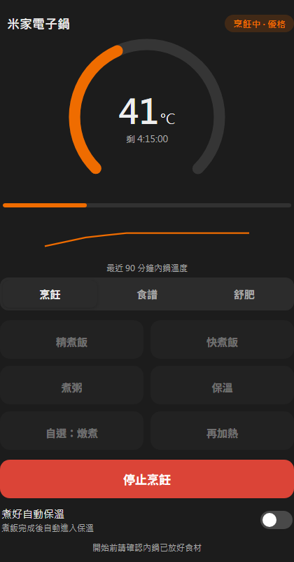
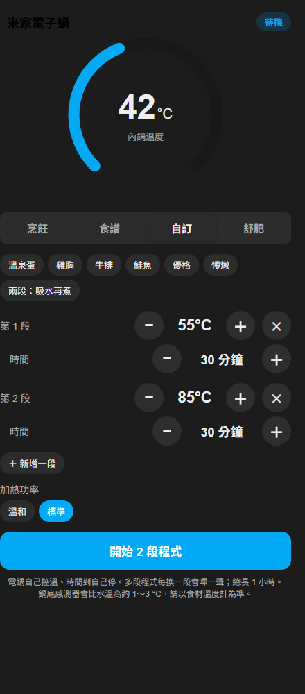

# Xiaomi Mijia Mini Rice Cooker × Home Assistant — a sous-vide cooker hack

**English** | [繁體中文](README.zh-TW.md)

Turn a cheap smart rice cooker (**Xiaomi Mijia Rice Cooker mini, `chunmi.cooker.tw1`**, the Taiwan model) into a
customizable low-temperature / sous-vide cooker, with a nice Home Assistant dashboard card.

The cooker exposes **no target-temperature setting**, but its recipes are plain 176-byte packets
(header + heating curve + CRC) that it accepts over the **local network**. This project:

1. **Starts any of the 15 built-in recipes from Home Assistant, including the app-only ones such as yogurt**, with
   your own duration, scheduled start and auto-keep-warm, without the Xiaomi cloud
   ([format](docs/recipe-format.md)).
2. Lets you **design your own constant-temperature recipes** (30-90 C, up to 24 h, several steps in a row) that the
   cooker runs by itself with its own thermostat ([custom recipes](docs/recipe-format.md#custom-constant-temperature-recipes)).

> **Not affiliated with Xiaomi.** This is a hobby reverse-engineering project. Use at your own risk — read the
> [safety notes](#safety-and-limits) first.


<p align="center">
 
 
</p>

*Screenshots are rendered from the real card; the “running” state uses sample values. The demo video below shows the earlier relay-based Sous-vide tab, which has since been removed in favour of the Custom tab.*


[](https://youtu.be/iS_5qySGZCk)

**▶ [Watch on YouTube](https://youtu.be/iS_5qySGZCk)** (≈44 s) | [download the 1080p mp4](docs/demo.mp4)

## What you get

- A custom Lovelace card `custom:cooker-card` with four tabs: temperature ring, status chip, two-tap
  confirmation, countdown.
- **Cook tab**: the 6 start modes (Fine Cook, Quick Cook, Congee, Keep Warm, *Custom slot*, Reheat) and an
  auto-keep-warm switch.
- **Recipes tab (new)**: all 11 recipes beyond the basic modes - Stew, **Yogurt**, Baby porridge, Instant
  noodles, Cake, Simmered soup, Reheat, Oden, Hot rice, Sweet rice, Speed rice - with adjustable cooking time
  (within the recipe's own limits), **scheduled start** and auto keep warm; yogurt also has an experimental
  **fermentation temperature** (30–50 °C). The packet is built in the browser and sent locally.
- **Custom tab (new)**: design your own recipe: pick a target temperature (30–90 °C), a time and a power level
  per step, up to 8 steps (presets: onsen egg, chicken breast, steak, salmon, yogurt, slow stew, soak-then-cook).
  One step is sent as a single packet (the cooker thermostats itself, no beeping); several steps run through
  `script.cooker_program` ([`ha/cooker_program.script.json`](ha/cooker_program.script.json)), which cancels, waits
  for idle and sends the next packet when a step ends. Each packet carries its own duration, so the cooker stops
  by itself even if HA dies. The temperature is held through the yogurt flow, see
  [recipe format](docs/recipe-format.md#custom-constant-temperature-recipes).
- [`tools/cookcode.py`](tools/cookcode.py) and [`data/recipes.json`](data/recipes.json): build and send recipe
  packets from scripts and automations.
- [Recipe format](docs/recipe-format.md) and [protocol notes](docs/protocol-notes.md): everything we learned
  (and did not learn) about this cooker.

 

## What does *not* work (and why)

- **Fully free heating curves.** Only two fields of a curve phase are decoded (target temperature and power;
  see [recipe format](docs/recipe-format.md)). The cooker's firmware still decides the phase flow of each recipe
  id, so the **Custom tab** builds constant-temperature holds (and chains of them), not arbitrary ramps.
- Boil-type recipes (cake, instant noodles, rice) heat flat-out to ~100–105 °C by design.

## Requirements

- Home Assistant with the [`xiaomi_miot`](https://github.com/al-one/hass-xiaomi-miot) integration
  (local mode), with your cooker added. Entities are expected as `sensor.chunmi_tw1_c3d7_cooker`,
  `sensor.chunmi_tw1_c3d7_temp`, `button.chunmi_tw1_c3d7_cancel_cooking`, … — replace `c3d7` with your device's
  suffix in the YAML and in the `E` table at the top of `card/cooker-card.js`.
- Helpers from [`ha/helpers.yaml`](ha/helpers.yaml), the script [`ha/cooker_program.script.json`](ha/cooker_program.script.json)
  (multi-step programs) and, optionally, the custom-slot automations in [`ha/automations.yaml`](ha/automations.yaml).

## Install

1. **Helpers**: merge `ha/helpers.yaml` into `configuration.yaml` (or create the same entities in the UI), restart.
2. **Script and automations**: create the script `cooker_program` from `ha/cooker_program.script.json` (needed for multi-step
   programs); optionally append `ha/automations.yaml` (names the *Custom* button), edit the entity IDs, reload.
3. **Card**: copy `card/cooker-card.js` to `/config/www/cooker-card.js`, then *Settings → Dashboards →
   Resources → Add*: URL `/local/cooker-card.js`, type *JavaScript module*. Add a card:
   ```yaml
   type: custom:cooker-card
   ```
4. The card's UI text is Traditional Chinese; the strings are plain literals in the file and easy to translate.

## How multi-step programs work

- A one-step custom recipe is a single packet sent to the cooker, which keeps the temperature itself.
- `script.cooker_program` (fields `packets`, `minutes`) runs the steps in order: cancel, wait until idle, send the packet,
  wait the step's minutes. Progress is shown through `input_number.cooker_prog_step` / `cooker_prog_total` and
  `input_datetime.cooker_prog_end`. Every packet carries its own duration, so the cooker stops by itself if HA dies.
- `cooker_slot5*` automations: 45 s after you press the *Custom* button, read the recipe byte from the `menu` property
  and show its name on the button.

## Safety and limits

- **Always test with water in the pot, and stay nearby.** Heating is started by software. Sending a recipe from
  the Recipes tab starts heating immediately.
- The pot sensor sits under the pot and reads 1-3 C above the water while heating; trust a food thermometer.
  Holds above ~80 C are lightly tested.
- The recipe presets (times and temperatures) are common home sous-vide values. **They are not verified for
  food safety**; low temperatures (< 55 °C) and long times carry a bacterial risk. Baby food: follow a
  paediatric guideline, not this repository.
- Never call the cooker's `set-factory-reset` action (siid 4, aiid 4) or write its `bell` property.
- A multi-step program depends on HA to switch steps: if HA dies mid-program the current step simply ends on the
  cooker's own timer (it never keeps heating indefinitely).

## A wish for Xiaomi

The heating-curve fields are still mostly undocumented and the cooker has no target-temperature property. If Xiaomi
documents the curve, truly free ramps would be easy. (No pressure, no affiliation. Just a hopeful note from a user who
loves the little cooker.)

## Data

`data/recipe-cake.csv`, `data/recipe-noodle.csv`: 10-second samples of temperature/phase for two Mi Home
recipes (water in the pot). Columns: time, state, last menu bytes, total minutes, left seconds, phase, °C.

## License

MIT, see [LICENSE](LICENSE). Contributions (other models, other recipes, protocol findings) welcome.
