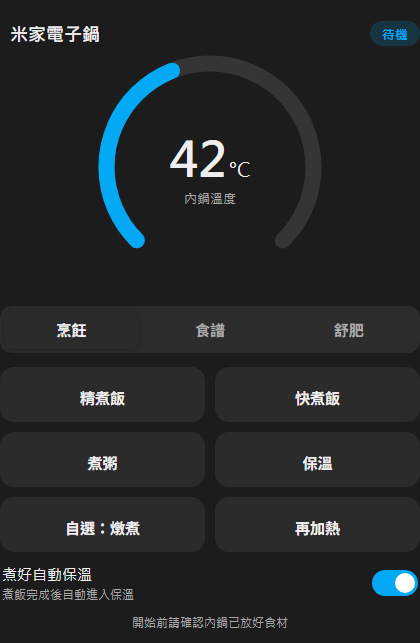
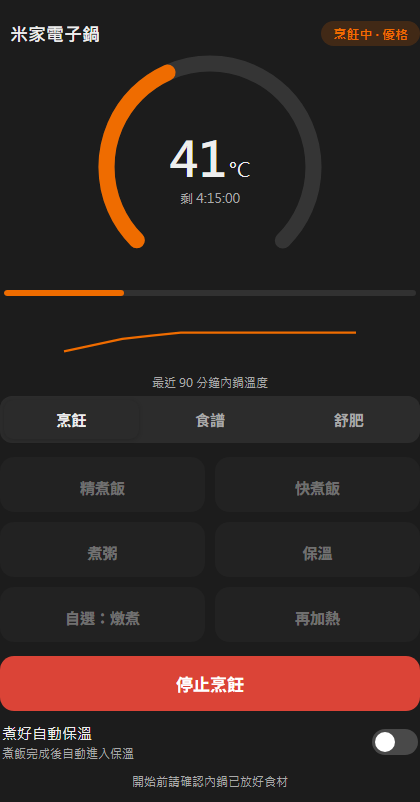
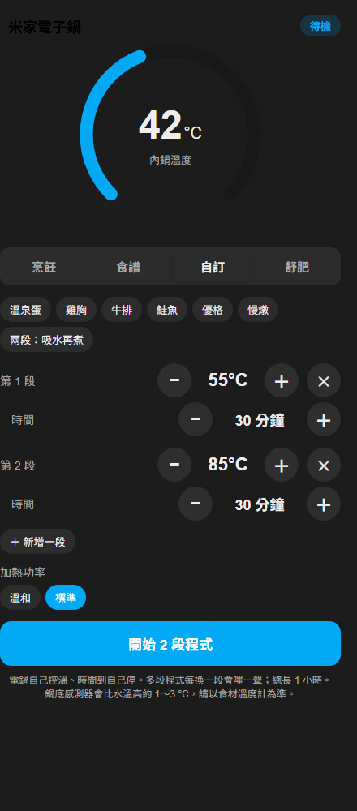
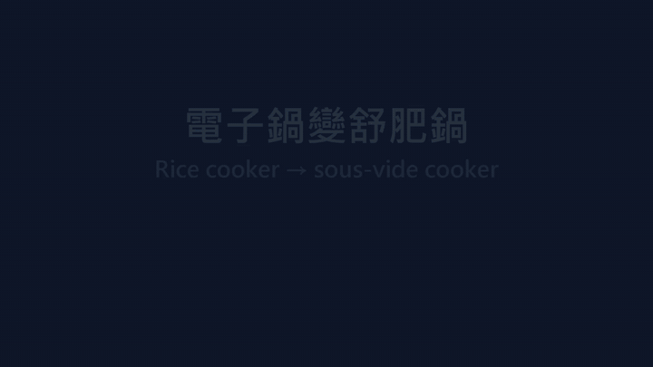

# 米家電子鍋 × Home Assistant：把電子鍋變成舒肥鍋

[English](README.md) | **繁體中文**

把一台便宜的智慧電子鍋（**米家電子鍋 mini，`chunmi.cooker.tw1`**，台灣版）改造成可客製化的低溫／舒肥鍋，
並提供好看的 Home Assistant 儀表板卡片。

這台電鍋**沒有開放目標溫度設定**，但它的食譜其實是 176 位元組的單純封包（表頭＋加熱曲線＋CRC），
並且接受**區網本地**送出。這個專案：

1. 在 Home Assistant 裡**啟動 15 種內建食譜，包含優格這類原本只能用 App 啟動的食譜**，可自訂時長、預約、
   自動保溫，不經小米雲端（[格式說明](docs/recipe-format.zh-TW.md)）。
2. 讓你**自己設計恆溫食譜**（30–90 °C、最長 24 小時、可多段串接），由電鍋用自己的恆溫器執行
   （[自訂食譜](docs/recipe-format.zh-TW.md#自訂恆溫食譜)）。

> **與小米無關。** 這是業餘的逆向研究專案，風險自負，請先讀[安全與限制](#安全與限制)。


<p align="center">
 
 
</p>

*截圖由真實卡片算繪；「進行中」的畫面使用示範數值。*



[](https://youtu.be/iS_5qySGZCk)

**▶ [在 YouTube 觀看](https://youtu.be/iS_5qySGZCk)**（約 44 秒）｜[下載 1080p mp4](docs/demo.mp4)

## 可以做到什麼

- 自訂 Lovelace 卡片 `custom:cooker-card`，四個分頁：溫度環、狀態標籤、兩段式確認、倒數。
- **烹飪分頁**：6 種啟動模式（精煮飯、快煮飯、煮粥、保溫、*自選*、再加熱）與煮好自動保溫開關。
- **食譜分頁（新）**：基本模式以外的 11 種食譜：燉煮、**優格**、嬰兒粥、泡麵、蛋糕、煲湯、再加熱、關東煮、
  熱米飯、香甜煮、極速煮；可調時長（在該食譜自己的範圍內）、**預約開始**、自動保溫；優格另有實驗性的**發酵溫度**（30～50 °C）。
  封包在瀏覽器裡組好、本地送出。
- **自訂分頁（新）**：自己設計食譜：每段選目標溫度（30–90 °C）、時間與功率，最多 8 段（預設：溫泉蛋、雞胸、
  牛排、鮭魚、優格、慢燉、先吸水再煮）。單段只送一個封包（電鍋自己控溫、不會一直嗶）；多段交給
  `script.cooker_program`（[`ha/cooker_program.script.json`](ha/cooker_program.script.json)），一段結束就取消、
  等待機、送下一段。每個封包都帶自己的時間，所以 HA 當機電鍋也會在該段結束時自己停。
  細節見[食譜格式](docs/recipe-format.zh-TW.md#自訂恆溫食譜)。
- [`tools/cookcode.py`](tools/cookcode.py) 與 [`data/recipes.json`](data/recipes.json)：在腳本與自動化裡組封包、送出。
- [食譜格式](docs/recipe-format.zh-TW.md)與[通訊協定筆記](docs/protocol-notes.zh-TW.md)：關於這台電鍋，
  我們摸清的與沒摸清的全部整理。

 

## 做不到的事（與原因）

- **完全自由的加熱曲線。** 曲線每個階段只解開兩個欄位（目標溫度與功率，見[食譜格式](docs/recipe-format.zh-TW.md)），
  各食譜編號的階段流程仍由電鍋韌體決定，所以**自訂分頁**做的是恆溫保持（以及多段串接），不是任意升降溫曲線。
- 煮滾型食譜（蛋糕、泡麵、煮飯）依設計會全力加熱到約 100～105 °C。

## 需求

- 安裝 [`xiaomi_miot`](https://github.com/al-one/hass-xiaomi-miot) 整合（本地模式）並加入電鍋。實體名稱預期為
  `sensor.chunmi_tw1_c3d7_cooker`、`sensor.chunmi_tw1_c3d7_temp`、`button.chunmi_tw1_c3d7_cancel_cooking`…，
  請把 YAML 與 `card/cooker-card.js` 開頭 `E` 表裡的 `c3d7` 換成你自己的裝置後綴。
- [`ha/helpers.yaml`](ha/helpers.yaml) 的輔助實體、[`ha/cooker_program.script.json`](ha/cooker_program.script.json)
  （多段程式腳本），以及選用的 [`ha/automations.yaml`](ha/automations.yaml)（替「自選」按鈕命名）。

## 安裝

1. **輔助實體**：把 `ha/helpers.yaml` 併入 `configuration.yaml`（或在介面建立同名實體），重新啟動。
2. **腳本與自動化**：用 `ha/cooker_program.script.json` 建立腳本 `cooker_program`（多段程式需要）；選用：把
   `ha/automations.yaml` 加到你的 `automations.yaml`（替「自選」按鈕命名），修改實體 ID 後重新載入。
3. **卡片**：把 `card/cooker-card.js` 複製到 `/config/www/cooker-card.js`，在「設定 → 儀表板 → 資源」新增
   網址 `/local/cooker-card.js`、類型 *JavaScript 模組*；新增卡片：
   ```yaml
   type: custom:cooker-card
   ```
4. 卡片介面文字是繁體中文，直接寫在檔案裡，要翻譯很容易。

## 多段程式原理

- 單段自訂食譜就是送一個封包，電鍋自己控溫。
- `script.cooker_program`（欄位 `packets`、`minutes`）依序執行：取消、等待機、送封包、等該段分鐘數。進度由
  `input_number.cooker_prog_step`／`cooker_prog_total` 與 `input_datetime.cooker_prog_end` 顯示。每個封包都帶
  自己的時間，所以 HA 當機時電鍋也會自己停。
- `cooker_slot5*` 自動化：按下「自選」45 秒後，讀 `menu` 屬性的食譜位元組，把名稱顯示在按鈕上。

## 安全與限制

- **請務必內鍋放水測試，並留在附近。** 加熱是由軟體啟動的。
- 鍋底感測器在內鍋下方，加熱時會比水溫高 1～3 °C，請以食材溫度計為準。約 80 °C 以上的恆溫只做過少量測試。
- 食譜預設（時間與溫度）是常見的家用舒肥數值，**沒有驗證食品安全**；低溫（< 55 °C）加長時間有細菌風險。
  嬰兒副食品請依兒科建議，不要依本專案。
- 千萬不要呼叫電鍋的 `set-factory-reset` 動作（siid 4、aiid 4），也不要寫入 `bell` 屬性。
- 多段程式靠 HA 換段：HA 中途當機時，目前這一段會在電鍋自己的計時到點後停止（不會無限加熱）。

## 給小米的小小願望

加熱曲線的欄位大部分仍沒有公開，電鍋也沒有目標溫度屬性。如果小米公開曲線格式，真正任意的升降溫就很容易了。
（沒有壓力、也沒有任何關係，只是一個喜歡這台小電鍋的使用者的小小期待。）

## 資料

`data/recipe-cake.csv`、`data/recipe-noodle.csv`：兩個米家食譜（鍋內有水）每 10 秒的溫度／階段紀錄。
欄位：時間、狀態、menu 末幾個位元組、總分鐘、剩餘秒、階段、°C。

## 授權

MIT，見 [LICENSE](LICENSE)。歡迎貢獻（其他型號、其他食譜、通訊協定發現）。
