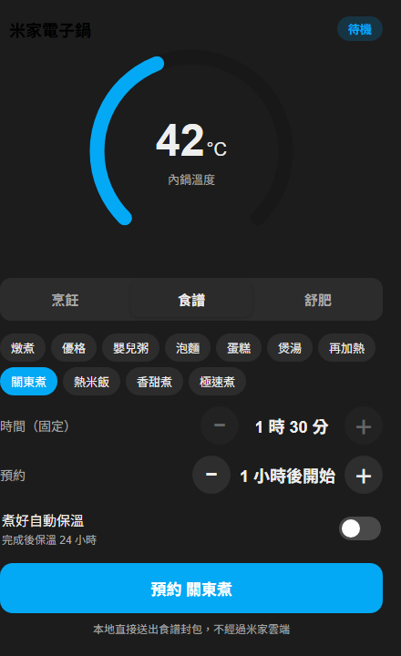

# 米家電子鍋 × Home Assistant：把電子鍋變成舒肥鍋

[English](README.md) | **繁體中文**

把一台便宜的智慧電子鍋（**米家電子鍋 mini，`chunmi.cooker.tw1`**，台灣版）改造成舒肥／恆溫鍋，
並提供專屬的 Home Assistant 儀表板卡片——**純區網、不經小米雲端**。

這台電鍋沒有開放目標溫度設定，但它的食譜其實是 176 位元組的單純封包（表頭＋加熱曲線＋CRC），
並且接受區網本地送出。本專案把封包解開了，所以你可以：

1. 在 Home Assistant 裡**啟動 15 種內建食譜**，包含優格這類原本只能用 App 啟動的食譜，並自訂時長、預約、
   煮好自動保溫（[封包格式](docs/recipe-format.zh-TW.md)）。
2. **自己設計恆溫食譜**：30–90 °C、最長 24 小時、最多 8 段串接。由電鍋用自己的恆溫器控溫，
   不是 Home Assistant 反覆開關，也不會一直嗶。

> **與小米無關。** 這是業餘的逆向研究專案，風險自負，請先讀[安全與限制](#安全與限制)。

<p align="center">
 
 
</p>

*截圖由真實卡片算繪；進行中的畫面使用示範數值。*


[](https://youtu.be/ur2tDmEzq1M)

**▶ [在 YouTube 觀看](https://youtu.be/ur2tDmEzq1M)**（約 42 秒）｜[下載 1080p mp4](docs/demo.mp4)

## 卡片功能

自訂 Lovelace 卡片 `custom:cooker-card`，三個分頁，另有溫度環、狀態標籤、所有啟動動作的兩段式確認與倒數。

- **烹飪**：6 種原廠啟動模式（精煮飯、快煮飯、煮粥、保溫、*自選*、再加熱）與煮好自動保溫開關。
  「自選」按鈕會顯示米家 App 裡存放的食譜名稱。
- **食譜**：基本模式以外的 11 種食譜：燉煮、**優格**、嬰兒粥、泡麵、蛋糕、煲湯、再加熱、關東煮、熱米飯、
  香甜煮、極速煮。可調時長（在該食譜自己的範圍內）、**預約開始**、自動保溫；優格另有**發酵溫度**（30～50 °C）。
  封包在瀏覽器裡組好、本地送出。
- **舒肥**：自己設計食譜：每段選目標溫度（30–90 °C）、時間與功率，最多 8 段。預設有溫泉蛋、雞胸、牛排、鮭魚、
  豬里肌、軟嫩雞腿、優格、慢燉與一個兩段範例，也能把自己調好的存成常用（★）。
  - 單段只送一個封包，電鍋自己控溫、時間到自己停。
  - 多段交給 Home Assistant 腳本，一段結束就換下一段。
  - 執行中卡片會顯示估計水溫（感測器讀數減 `offset`）、溫度環上的目標溫度，以及最近 90 分鐘的溫度走勢。

另有兩條選用的自動化：**逾時保險**（預計結束後 5 分鐘電鍋還在煮，就取消並通知）與**完成通知**。

其他內容：[`tools/cookcode.py`](tools/cookcode.py) 與 [`data/recipes.json`](data/recipes.json) 可在腳本裡組封包、送出；
[封包格式](docs/recipe-format.zh-TW.md)與[通訊協定筆記](docs/protocol-notes.zh-TW.md)整理了關於這台電鍋
摸清的與沒摸清的全部發現。

## 需求

- 安裝 [`xiaomi_miot`](https://github.com/al-one/hass-xiaomi-miot) 整合（本地模式）並加入電鍋。實體名稱預期為
  `sensor.chunmi_tw1_c3d7_cooker`、`sensor.chunmi_tw1_c3d7_temp`、`button.chunmi_tw1_c3d7_cancel_cooking`…，
  其中 `c3d7` 是你的裝置後綴。
- [`ha/helpers.yaml`](ha/helpers.yaml) 的輔助實體，與 [`ha/cooker_program.script.json`](ha/cooker_program.script.json)
  腳本（多段程式需要）。[`ha/automations.yaml`](ha/automations.yaml) 的自動化是選用。

## 安裝

1. **輔助實體**：把 `ha/helpers.yaml` 併入 `configuration.yaml`（或在介面建立同名實體），重新啟動。
2. **腳本**：用 `ha/cooker_program.script.json` 建立 id 為 `cooker_program` 的腳本，把 `c3d7` 換成你的後綴。
3. **自動化（選用）**：把 `ha/automations.yaml` 加到你的自動化，換掉 `c3d7` 與 `notify.persistent_notification`
   （改成你的手機，例如 `notify.mobile_app_xxx`），重新載入。
4. **卡片**，二選一：
   - **HACS**（建議）：*HACS → ⋮ → 自訂儲存庫*，加入 `https://github.com/ilshang2/xiaomi-rice-cooker-ha`，
     類別選「儀表板」，再安裝 *Xiaomi Rice Cooker Card*。
   - **手動**：把 `dist/cooker-card.js` 複製到 `/config/www/cooker-card.js`，在「設定 → 儀表板 → 資源」新增網址
     `/local/cooker-card.js`、類型 *JavaScript 模組*。
5. 新增卡片：
   ```yaml
   type: custom:cooker-card
   device: c3d7      # 你的裝置後綴（預設 c3d7）
   offset: 2         # 感測器比水溫高約幾 °C（預設 2）
   ```

常用食譜（★）存在你使用的那個瀏覽器（localStorage）裡。卡片介面文字是繁體中文，直接寫在檔案裡，要翻譯很容易。

## 運作原理

- **單段**：卡片送出一個封包（`xiaomi_miot.call_action`，siid 4、aiid 1）。電鍋跑優格流程，目標溫度與時間由你設定。
  目標溫度與功率寫在加熱曲線裡；優格流程約 30 分鐘後會換階段，所以兩個階段都設成同一個溫度
  （實測：55 °C 恆溫 42 分鐘，鍋底感測器維持在 54–58 °C，時間到電鍋自己停機）。
- **多段**：`script.cooker_program` 依序執行：取消、等待機、送封包、等該段分鐘數，並用
  `input_number.cooker_prog_step`／`cooker_prog_total`／`cooker_prog_target` 與 `input_datetime.cooker_prog_end`
  顯示進度。在電鍋或 App 手動取消，整個程式會中止並通知你。
- **自選按鈕名稱**：`cooker_slot5*` 自動化在你按下「自選」45 秒後，讀 `menu` 屬性的食譜位元組，把名稱顯示在按鈕上。

細節與實測見[食譜格式](docs/recipe-format.zh-TW.md#自訂恆溫食譜)與[通訊協定筆記](docs/protocol-notes.zh-TW.md)。

## 做不到的事（與原因）

- **完全自由的加熱曲線。** 曲線每個階段只解開兩個欄位（目標溫度與功率）。各食譜編號的階段流程由電鍋韌體決定，
  所以舒肥分頁做的是恆溫保持（以及多段串接），不是任意升降溫曲線；其他曲線欄位在我們的測試裡看不到作用。
- 煮滾型食譜（蛋糕、泡麵、煮飯）依設計會全力加熱到約 100～105 °C。
- 電鍋沒有目標溫度屬性，也讀不到真正的水溫。

## 安全與限制

- **請務必內鍋放水測試，並留在附近。** 加熱是由軟體啟動的，送出食譜就會立刻開始加熱。
- 鍋底感測器在內鍋下方，加熱時比水溫高約 2～4 °C（剛加冷水時更不準），請以食材溫度計為準。約 80 °C 以上的恆溫只做過少量測試。
- **電鍋通常在時間到時自己停，但不保證**：測試中有兩次沒停、改成 480 分鐘恆溫繼續跑（之後重測無法重現）。多段程式每段結束都會主動取消，
  選用的逾時保險自動化也會取消「預計結束後 5 分鐘還在煮」的情況。Home Assistant 或網路不穩時，請不要讓程式在無人看管下執行。
- 食譜預設（時間與溫度）是常見的家用舒肥數值，**沒有驗證食品安全**；低溫（< 55 °C）搭配長時間有細菌風險。
  嬰兒副食品請依兒科建議，不要依本專案。
- 千萬不要呼叫電鍋的 `set-factory-reset` 動作（siid 4、aiid 4），也不要寫入 `bell` 屬性。

## 資料

- `data/recipes.json`：15 個食譜封包。
- `data/hold-55c.csv`：實測的 55 °C 恆溫（42 分鐘、1 公升水）：秒數、狀態、階段、感測器 °C。
- `data/recipe-cake.csv`、`data/recipe-noodle.csv`：兩個米家食譜（鍋內有水）每 10 秒的溫度／階段紀錄。
  欄位：時間、狀態、menu 末幾個位元組、總分鐘、剩餘秒、階段、°C。

## 授權

MIT，見 [LICENSE](LICENSE)。歡迎貢獻（其他型號、其他食譜、通訊協定發現）。
